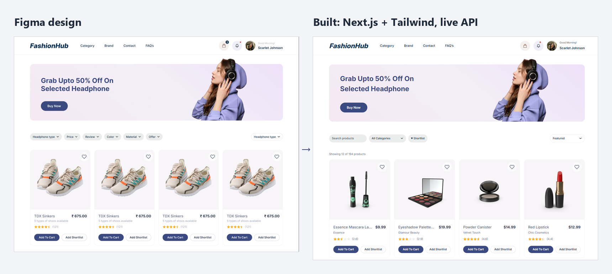

### Hi, I'm Ian 👋

Frontend developer in Manila. I turn Figma designs into responsive UI for web (React / Next.js) and mobile (Flutter), and wire them to REST APIs.

- **Now:** Lead Frontend Developer at Flair, a live Flutter community app (web, iOS, Android).
- **Before:** Frontend Developer at Ecosaver, where I built the production Next.js frontend.

**Stack:** Next.js · React · TypeScript · Tailwind CSS · Flutter · Dart · REST APIs · Figma · Git

### Featured: Figma → Next.js

**[FashionHub product listing](https://github.com/ianquilatanwe/product-listing-demo)** · Live: _coming soon_

I took a free Figma Community e-commerce design and built it as a working, responsive store in Next.js + Tailwind CSS.

- **Matches the design:** header, promo banner, filter pills, product cards and pagination, from 375px phones to 1440px desktops.
- **Fills in what a static design leaves out:** hover, focus, loading, empty, error and offline states, plus every button state (Adding… → ✓ Added, Out of stock).
- **Made it real:** the placeholder pills became working search, category, shortlist and sort; the cards load ~200 live products from a REST API; cart with Undo and a Quick View dialog.
- **Fixed the design where it failed:** its light greys failed WCAG contrast (2.6:1), so I used the kit's darker grey (4.8:1). 0 axe violations, keyboard-friendly.

Design by Kirit Goti ([CC BY 4.0](https://creativecommons.org/licenses/by/4.0/)) · data from DummyJSON.

Most of my production work is in private company repos, so these demos are small public examples of the same kind of work.

### Work with me

Small, clearly scoped fixed-price tasks: UI from Figma, frontend bug fixes, API wiring, responsive layouts.
I work 12 PM – 11 PM Manila time (overlaps US East Coast mornings) and reply the same day.

[Hire me on Upwork](https://www.upwork.com/freelancers/~011c7ba66b3e0501a5) · ✉️ [ianquilatan.we@gmail.com](mailto:ianquilatan.we@gmail.com)
